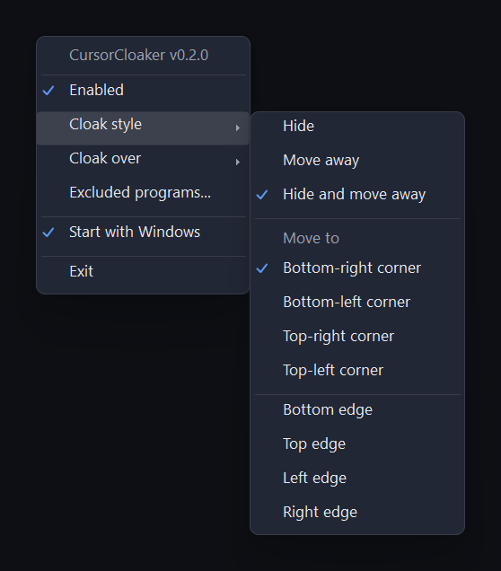
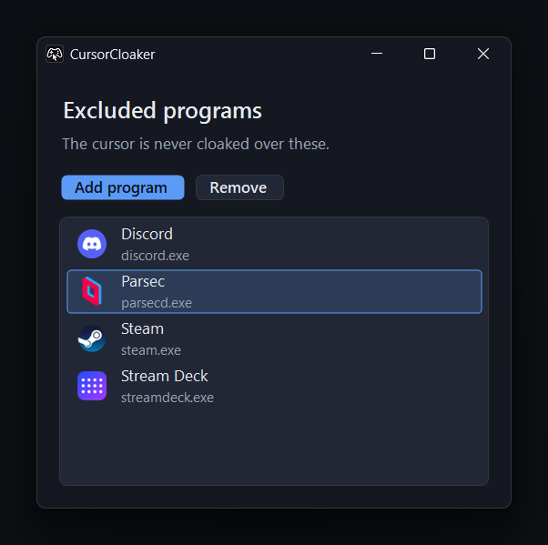
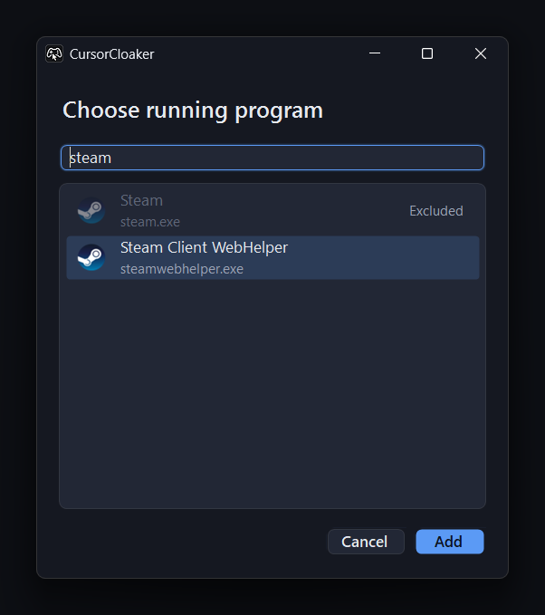

<p align="center"></p>

<h1 align="center">CursorCloaker</h1>

<p align="center">
  Hides the mouse cursor while you play with a controller, and only then.<br>
  <a href="https://github.com/SpookyPirate/CursorCloaker/releases/latest"><b>Download for Windows</b></a>
</p>

Playing PC games from the couch, in Steam Big Picture, an emulator frontend or over Moonlight or
Steam Link, often means a mouse cursor parked in the middle of the screen. Other cursor hiders
hide it whenever the mouse sits still, everywhere in Windows, including while you're reading a web page.
CursorCloaker reacts to the **controller** instead. Press a button or move a stick over a fullscreen
game and the cursor disappears. Touch the mouse and it comes straight back. Ordinary desktop use is
never affected.

<p align="center">
  
</p>

## Download

1. Download `CursorCloaker-v<version>.zip` from the [latest release](https://github.com/SpookyPirate/CursorCloaker/releases/latest).
2. Extract it somewhere permanent, for example `Documents` or `D:\Tools`. You get a `CursorCloaker` folder.
3. Run `CursorCloaker\CursorCloaker.exe`. It sits in the system tray and starts with Windows from now on.

There's nothing to install. It needs Windows 10 or 11, which already include the .NET Framework 4.8 it
runs on.

**Upgrading:** extract the new zip to the same place. The new `CursorCloaker` folder lands on the old
one, and your settings are kept.

> **SmartScreen:** builds are unsigned, so Windows may warn the first time you run one. Choose **More info**, then **Run anyway**.
>
> **Can't see the icon?** Windows 11 tucks new tray icons behind the **^** next to the clock. Drag
> CursorCloaker onto the taskbar, or turn it on under **Settings > Personalization > Taskbar > Other system tray icons**.

## How it works

| You… | The cursor… |
| --- | --- |
| press a button or move a stick over a fullscreen game | disappears and moves out of the way, to a corner or edge you choose |
| move or click the mouse | comes back, and stays until you use the controller again |
| switch to a normal window, the desktop or an excluded program | comes back |
| lock the PC, sign out, or quit CursorCloaker | comes back |

- **Any controller.** It reads Xbox and 8BitDo pads through XInput, and Switch Pro, DualShock, DualSense and DirectInput pads as HID devices. It
  doesn't need Steam Input, and a stick that drifts a little won't keep hiding the cursor.
- **Built for streaming.** Over Moonlight/Sunshine or Steam Link, a mouse on the streaming client brings the
  cursor back too.
- **Never stuck invisible.** Your normal cursors (including custom ones) are restored on every exit,
  after a crash, when the PC locks, and each time CursorCloaker starts.

## Settings

Click the tray icon:

- **Enabled**: pause or resume. The icon greys out while paused.
- **Cloak style**: hide the cursor, move it away, or both (the default). Moving it helps with games that
  draw their own cursor. The same submenu sets where it moves to: any corner (bottom-right by default) or the
  middle of any edge.
- **Cloak over**: fullscreen programs only (the default), or all programs.
- **Excluded programs…**: programs CursorCloaker never touches.
- **Start with Windows**

<p align="center">
  
  &nbsp;
  
</p>

To exclude a program, browse to its `.exe`, or pick it from your running programs or open windows.
Changes apply immediately.

Everything is also stored in `CursorCloaker\CursorCloaker.ini`, which you can edit while the app is closed:

```ini
[CursorCloaker]
; true | false
Enabled=true
; Hide | Park | HideAndPark
Mode=HideAndPark
; Where Park moves the cursor: BottomRight | BottomLeft | TopRight | TopLeft | BottomEdge | TopEdge | LeftEdge | RightEdge
ParkPosition=BottomRight
; FullscreenOnly | AllPrograms
Scope=FullscreenOnly
; Milliseconds between controller input and cloaking (0-10000)
HideDelayMs=0
StartWithWindows=true
; Programs never cloaked over, separated by ;
Exclude=discord;steam
```

## Troubleshooting

- **The cursor is invisible and won't come back.** Start CursorCloaker again; it restores the cursors when it
  starts. Signing out of Windows and back in also restores them.
- **A controller doesn't hide the cursor.** Check that CursorCloaker is enabled and the game is fullscreen, or
  switch **Cloak over** to **All programs**. A Switch Pro Controller that Steam has switched into its
  extended mode may not be detected while Steam is running.
- **A program keeps showing or hiding the cursor at the wrong time.** Add it to **Excluded programs**.

## Build from source

You need the .NET SDK 10 (pinned in `global.json`). From the repo root:

```powershell
dotnet test
powershell -ExecutionPolicy Bypass -File scripts\build.ps1   # -> dist\CursorCloaker-v<version>.zip
```

[RUNNING.md](RUNNING.md) has every command, [TECHSTACK.md](TECHSTACK.md) explains how it's built and
why, [docs/DESIGN.md](docs/DESIGN.md) is the full behaviour spec, and [HANDOFF.md](HANDOFF.md) describes the current state.

## License

[MIT](LICENSE)
